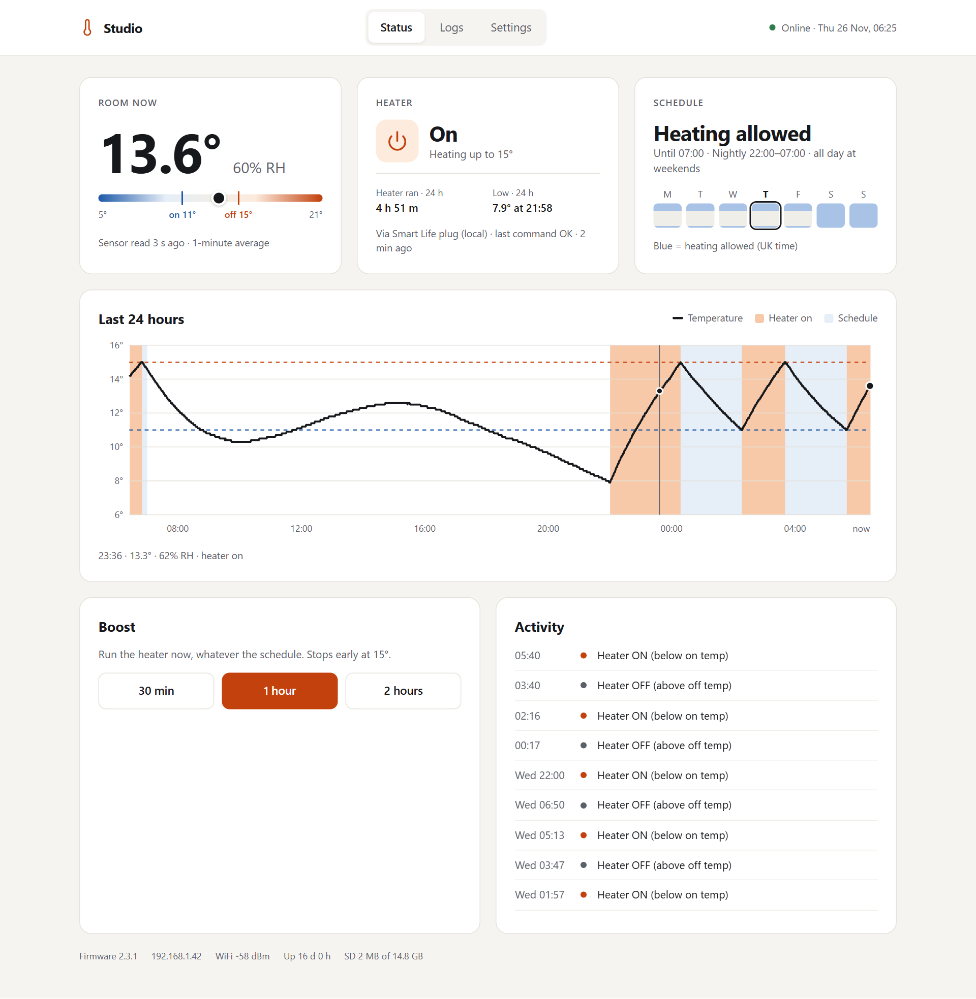
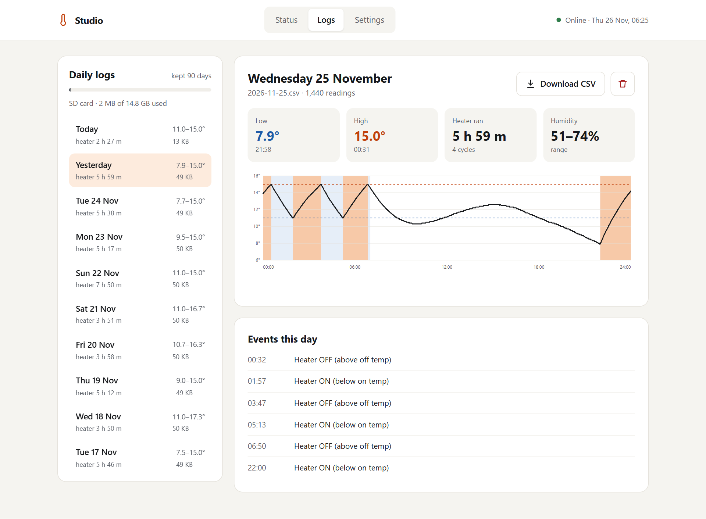
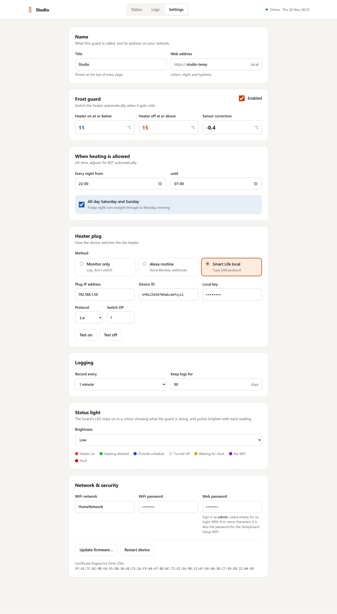
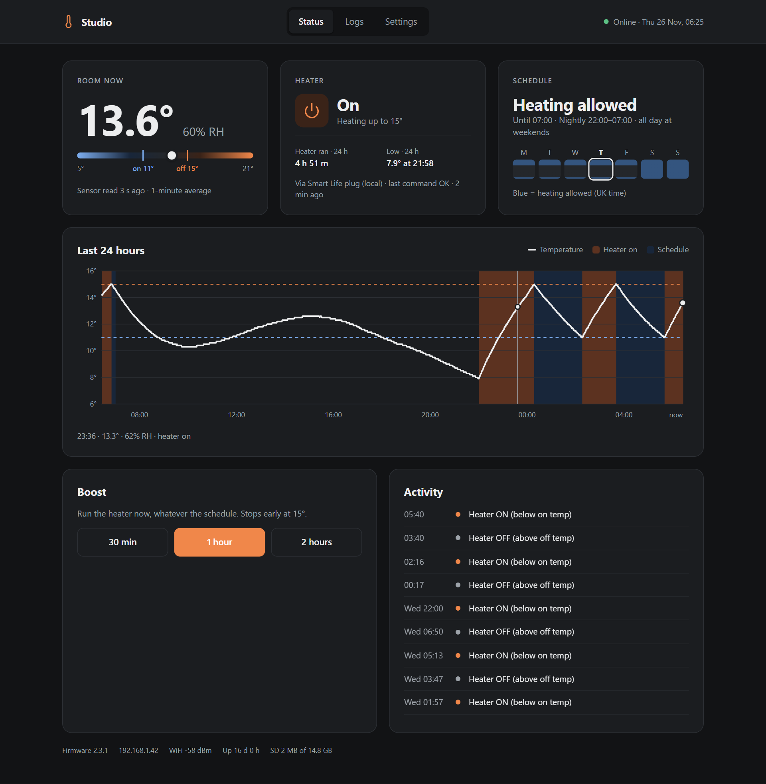
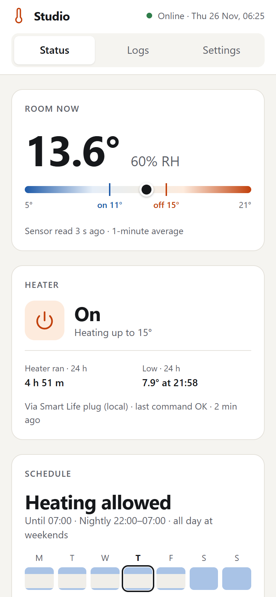

# Temperature Guard

A frost guard for a studio, shed, garage or greenhouse, built on an ESP32-S3 Feather with a DHT11
sensor and an SD card. When the room drops to **11 °C** or below it switches a heater on, and when it
reaches **15 °C** it switches it off. By default this only happens **every night (22:00–07:00) and all
day Saturday/Sunday**, UK time. Every value, plus the guard's name, can be changed in the web UI.

The heater is switched through a Smart Life / Tuya smart plug (directly over the LAN), or through
webhooks such as Voice Monkey triggering an Alexa routine. It can also just monitor and log.



## Web UI
Everything is done from a web page served by the device over HTTPS, and it works on a phone.

* **Status**: current temperature and humidity against the on/off thresholds, whether the heater is on
  and why, heater run time and low over the last 24 h, when heating is next allowed, a 24-hour
  chart, **Boost** (run the heater for 30 min / 1 h / 2 h regardless of the schedule), and recent activity.
* **Logs**: one entry per day with its temperature range and heater time; pick a day for its chart,
  low/high, heater cycles, humidity range and events, or download/delete its CSV.
* **Settings**: name and web address, thresholds, schedule, heater plug (with **Test on / Test off**),
  logging, status light, WiFi, web password, firmware update and restart.

| Logs | Settings |
|---|---|
|  |  |

| Dark mode | Phone |
|---|---|
|  |  |

Screenshots are from the mock device in `tools/` with simulated data (see [Developing the web UI](#developing-the-web-ui)).

## Getting started

1. Wire it up (see [Hardware](#hardware)) and flash it: `pio run -t upload`.
2. On first boot there is no WiFi configured, so the device opens an access point
   **TempGuard-Setup** (password `tempguard`). Join it and browse to http://192.168.4.1.
   Once you set a web password of 8 or more characters, it becomes the setup network's password
   (from the next time that network starts), so the published default only works on a device that
   has no web password.
3. Accept the certificate warning (see [HTTPS](#https)), then under **Settings**:
   * **Name**: give it a title (e.g. *Studio*) and a web address (e.g. `studio-temp`, giving
     `https://studio-temp.local`).
   * **Network & security**: enter your WiFi details and set a web password.
   * **Heater plug**: choose how the heater is switched (see [Switching the heater](#switching-the-heater)).
4. Save. The device joins your WiFi and is then at `https://<web address>.local`.

To build with your own defaults instead, add flags to `platformio.ini`:
```
build_flags =
	-DDEFAULT_TITLE='"Garage"'
	-DDEFAULT_HOSTNAME='"garage-temp"'
	-DDEFAULT_WIFI_SSID='"MyNetwork"'
	-DDEFAULT_WIFI_PASS='"secret"'
```
Defaults only apply to a device with no saved settings. Don't commit your WiFi password.

## HTTPS
Plain http:// redirects to https. The device makes its own self-signed certificate (ECDSA P-256)
on first boot, and the private key never leaves the device. The certificate names `<host>.local`,
`<host>`, the WiFi IP and the setup address 192.168.4.1. It is replaced when the web address or WiFi
IP changes, or within 30 days of expiry (it is valid for 800 days); the device checks every few
seconds while on WiFi, and waits for the clock to sync so a new certificate gets the right dates.
Falling back to the setup access point keeps the existing certificate. Reserve the device's IP address
in your router so the certificate (and any trust you gave it) doesn't change when DHCP hands out a new
address.

Browsers warn the first time ("not private"); choose *Advanced → Proceed*. To check you are talking
to the real device, compare the fingerprint the browser shows with the one under
**Settings → Network & security** or on the serial console at boot. To stop the warning on a Windows PC,
save the `pem` from `https://<host>.local/api/cert` as `guard.crt` and run
`certutil -user -addstore Root guard.crt`.

The first page load takes about 1 s for the TLS handshake.

## Hardware

| Part | Pin |
|---|---|
| DHT11 data | GPIO 7 |
| SD (Adafruit SPI flash SD breakout) SCK / MISO / MOSI / CS | 12 / 13 / 11 / 10 |
| Status LED (NeoPixel data) | GPIO 21 |

Board: Feather-style ESP32-S3. Change the pins at the top of `src/main.cpp`. For the LED on a stock
Adafruit Feather ESP32-S3 (data on GPIO 33, power on GPIO 21) build with
`-DSTATUS_LED_PIN=33 -DSTATUS_LED_POWER_PIN=21`.

## How it decides

The controller runs every 2 s and uses the average of the last 12 DHT11 readings (about 1 minute).

1. **Boost** active → heater on until boost ends or the off temperature is reached (a sensor
   failure cancels the boost)
2. Control disabled / time not synced yet / outside schedule → **off**
3. No valid sensor reading for 5 min → **off** (fail safe)
4. temp ≤ on temp → **on**; temp ≥ off temp → **off**; in between → keep the current state (hysteresis)

A failed command is retried with backoff (30 s, 1 min, 2 min … up to 30 min) so a misconfigured
webhook cannot exhaust a monthly quota. In Tuya mode the desired state is also re-sent every 10 min,
so the plug gets corrected if someone switched it by hand. While WiFi is down nothing is sent and the
backoff does not grow, so the heater is switched as soon as WiFi returns; saving settings also resets it.

The schedule uses UK time (GMT/BST). To change the time zone, edit `TZ_UK` in `src/main.cpp`
(a POSIX TZ string).

## Switching the heater

Alexa has no API that lets a device tell it to switch something on, so there are two options. Pick
one under **Settings → Heater plug**, or choose **Monitor only** to just record temperatures.

### Option A: Smart Life / Tuya plug, local
The ESP32 talks to the plug directly over the LAN, with no cloud and no Alexa involved. Alexa keeps
working as normal. The plug must be on the same network as the guard. You need the plug's
**device ID**, **local key** and **IP**:

1. Create a free account at https://platform.tuya.com, create a Cloud project (pick your data centre),
   and under *Devices → Link App Account* scan the QR code with the Smart Life app.
2. On a PC: `pip install tinytuya` then `python -m tinytuya wizard`, and enter the project's Access
   ID/Secret. It writes `devices.json` with each device's `id` and `key`. These files contain secrets
   and are git-ignored.
3. `python -m tinytuya scan` shows the plug's IP and protocol version (3.3 or 3.4). Reserve that IP
   in the router so it doesn't change.
4. Enter the values in Settings, save, then press **Test on / Test off**. After a test, automatic
   control pauses for 1 minute so you can see the result, then puts the plug back where it should be.

The local key changes if the plug is removed and re-paired in the Smart Life app.

### Option B: Webhooks → Alexa routine (e.g. Voice Monkey)
1. At https://voicemonkey.io, create two **Routine Triggers** (v3; the free plan allows 3 triggers
   and 200 calls a month), e.g. `heater-on` and `heater-off`.
2. In the Alexa app, create two routines: *When* → Smart Home → the Voice Monkey trigger,
   *Action* → turn the heater plug on (or off).
3. Paste the two trigger URLs
   (`https://api-v3.voicemonkey.io/trigger?token=…&device=…`) into Settings, save, and test.

Any URL that accepts an HTTP GET works. The URLs contain your token, so they are hidden in Settings
once saved (like passwords); still, set a web password. Each change of heater state uses one call.
At every boot the device sends the state it wants once so the plug starts from a known state: usually
**off** until the clock syncs, then **on** if it is cold, so a boot can use one or two calls.

## Status light

The Feather's on-board RGB LED stays on at a low level, and pulses brighter each time the sensor is
read (every 5 s). A failed reading flashes red. It shows dim white while the device starts up. Brightness (off / low / medium / high) is under
**Settings → Status light**.

| Colour | Meaning |
|---|---|
| Orange | Heater on |
| Green | Heating allowed, heater off (warm enough) |
| Blue | Outside the schedule |
| White | Frost guard turned off |
| Yellow | Waiting for the clock to sync |
| Purple | No WiFi (setup access point) |
| Red | Fault: no sensor reading for a minute, or the last heater command failed |

## Logging

* `/logs/YYYY-MM-DD.csv` on the SD card, one row per log interval (default 60 s) plus event rows
  (heater on/off, boot, settings saved, errors).
* Files older than the retention period (default 90 days) are deleted automatically. The oldest
  days are also deleted if the card goes above 90 % full.
* The Logs tab shows each day's range, heater time and chart, and lets you download or delete it.
* After a reboot the 24-hour chart is reloaded from the SD card.

## Settings and WiFi
All settings are stored in flash (NVS namespace `tempguard`) and survive power cycles. If the saved
WiFi is unavailable for 2 minutes, the device opens the **TempGuard-Setup** access point so you can
still reach it at http://192.168.4.1. Its password is your web password if that is 8 or more
characters, otherwise `tempguard`.

**Factory reset:** hold the **BOOT** button for 10 seconds while the device is running. All settings
are erased and it restarts with the setup access point (password `tempguard`). Logs on the SD card are
kept. Over USB, `pio run -t erase` followed by `pio run -t upload` does the same (and also removes the
certificate). Build with `-DRESET_BUTTON_PIN=<gpio>` to use another button.

## Building / updating

```
pio run -t upload    # USB
```
Over WiFi: **Settings → Update firmware…** and pick `.pio/build/feather-s3/firmware.bin`, or
```
curl -k --data-binary @.pio/build/feather-s3/firmware.bin https://<host>.local/api/update
```
If a web password is set, add `-u admin:<password>` to the curl command.

USB upload note: on the Feather ESP32-S3 the auto-reset into the bootloader sometimes makes the board
disappear from USB. If that happens, hold **BOOT**, tap **RESET**, release BOOT, and upload again. If
it then stays in download mode, run
`esptool --chip esp32s3 -p COMx --before no-reset --after watchdog-reset chip-id`.

## Developing the web UI
The page lives in `src/web_ui.h`. To work on it without hardware, run a mock device that serves the
same page with a fake API and about two weeks of simulated readings (Node 22+, no dependencies):
```
node tools/mock-server.js        # http://localhost:8080
node tools/screenshots.js        # regenerate docs/screenshots/ (needs Chrome or Edge)
```

## API
All endpoints need HTTP Basic auth (user `admin`) when a web password is set, except `/api/cert`.
POST and DELETE requests from a browser are refused unless they come from the device's own page
(checked with the `Origin` header), so other websites can't use your login; curl and scripts are unaffected.

`GET /api/status`, `GET/POST /api/settings`, `GET /api/history`, `POST /api/heater?cmd=on|off`,
`POST /api/boost?minutes=N` (0 cancels), `GET /api/logs`, `GET|DELETE /api/log?f=<file>`,
`POST /api/update` (raw firmware body), `POST /api/reboot`, `GET /api/cert`.

## License
[MIT](LICENSE)
